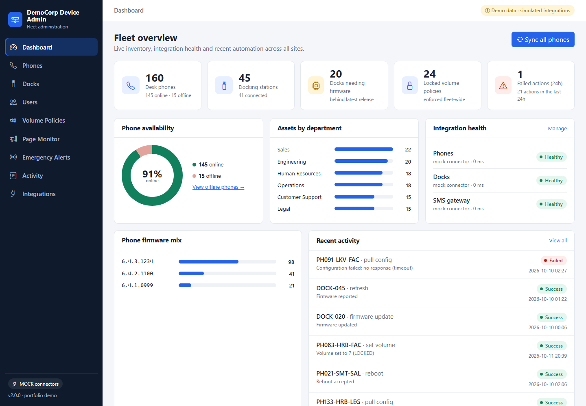
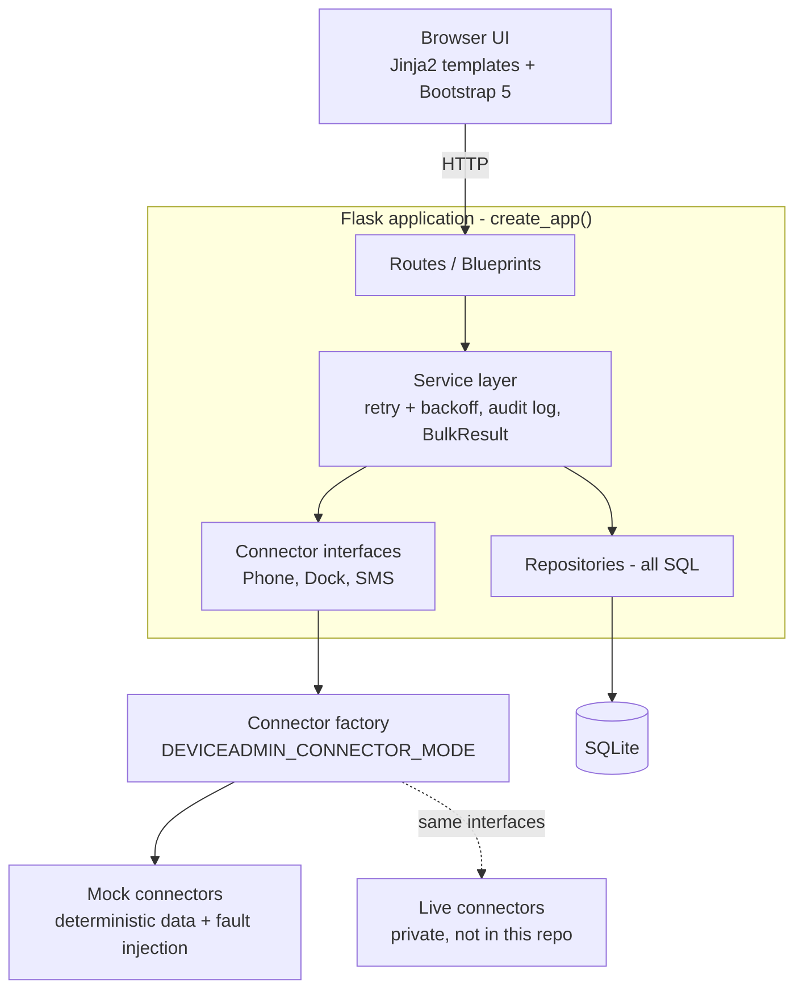
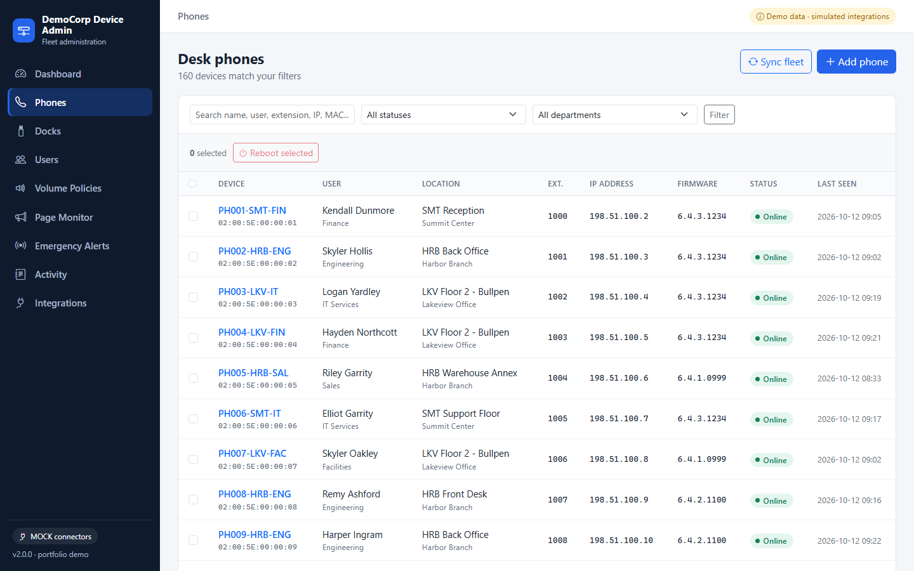
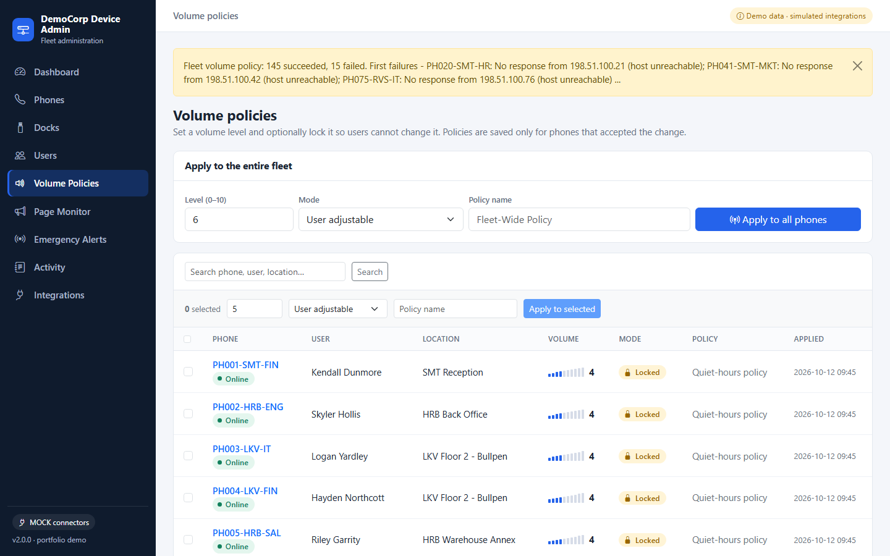

# DeviceAdmin

[](https://github.com/TommyChivite-23/deviceadmin/actions/workflows/ci.yml)


**A web dashboard for managing a fleet of desk phones and docking stations from one screen: inventory, bulk
actions, firmware, volume policy, paging alerts and an audit trail. It talks to the outside world only
through a connector layer, so everything here runs on simulated devices and fictional data.**

> **About this edition.** This is a *public portfolio version* of an internal tool I built. All real integrations
> were replaced with mock connectors, and all data (users, devices, addresses, phone numbers) is fictional
> ("DemoCorp"). The architecture is intentionally preserved: swapping the mocks for real connectors is a
> configuration change, not a rewrite.

<!-- SCREENSHOT 1: docs/images/01-dashboard.png -->


**Video walkthrough (about 2.5 minutes, captioned, no audio)** - **Video walkthrough (about 2.5 minutes, captioned, no audio):**

https://github.com/user-attachments/assets/10b54351-ae02-4582-becd-c81972a95739

## Why I built it

In an organisation managing roughly 150+ devices, routine device work was done one device at a time:
open each phone's admin page, find the setting, change it, move to the next. Volume settings, reboots, firmware
checks and paging alerts all had that shape. It was slow, easy to get wrong (nothing recorded which phones were
actually changed) and hard to audit.

DeviceAdmin turns those chores into single actions across the fleet, shows which devices succeeded or failed and
why, and writes every action to an audit log.

## Before vs. after

| | Manual, device by device | With DeviceAdmin |
|---|---|---|
| Apply one volume policy to the whole fleet | ~30+ minutes *(my estimate)* | one click, **under ~2 minutes** *(my estimate for the original deployment)* |
| Scale | ~150+ assets | same workflow, same click |
| Know what actually changed | not recorded | per-device result + audit log |

> **Honesty note.** The "30+ minutes" and "under ~2 minutes" figures are *representative estimates* from the
> original workflow; they are **not** measured in this repository. What the repo *can* demonstrate is that the
> orchestration is fast: `python scripts/benchmark_fleet_ops.py --latency-ms 100` runs a fleet sync and a
> fleet-wide volume policy over 160 mock phones with a simulated 100 ms network delay per call. On my machine
> that took about **3 s** each, compared with ~16 s if the calls were made one after another. It measures the
> software against mocks only, not real device latency and not the manual baseline.

## Features

* **Phone & dock inventory** - search, filter, paginate (160 phones + 45 docks seeded), add/edit/delete,
  assignment to users, locations and departments.
* **Fleet actions** - sync status from every phone in parallel, bulk reboot, bulk dock firmware update.
* **Volume policies** - set a level (0-10), optionally lock it, apply to one phone, a selection or the whole
  fleet. A policy is stored only for phones that actually accepted it.
* **Firmware management** - dry-run first (shows the exact requests without sending them), history of every
  attempt, "update available" detection for docks.
* **Page monitor** - background thread that detects paging/intercom calls, resolves who paged whom, applies a
  cooldown, and texts a notification list. Includes a simulator for demos.
* **Emergency broadcast** - one SMS to all active contacts with per-recipient delivery results and history.
* **Audit trail** - every action (and failure) is logged and filterable.
* **Integrations page** - live connector health, call counts, last error, and **fault injection**
  (outage, timeout, rate limit, bad credentials) so you can watch error handling work.
* **Operational basics** - `/healthz`, structured logging, env-var configuration, friendly error pages,
  loading/empty/error states.

## Architecture



**Application -> Connector interface -> Mock connector -> Mock data.** Routes parse requests and call services;
services hold the rules and talk to devices only through abstract connectors; repositories own all SQL. Connectors
raise typed errors (`ConnectorTimeout`, `RateLimitError`, `InvalidRequestError`, ...) and a retry helper
retries only the transient ones. Full details, data model and sequence diagrams: **[docs/ARCHITECTURE.md](docs/ARCHITECTURE.md)**.

## Technologies

Python 3.12 · Flask 3 (application factory, blueprints) · SQLite · Jinja2 · Bootstrap 5 ·
`concurrent.futures` · gunicorn · pytest + pytest-cov · Ruff (lint + format) · Docker / Docker Compose ·
GitHub Actions.

## Quick start

### Option A - Docker Compose

```bash
docker compose up --build
# open http://localhost:5000
```

No `.env` file is required (every setting has a safe default). To customise, copy `.env.example` to `.env`.
Compose starts one container (`web`) and keeps the SQLite database on a named volume. Stop with `Ctrl+C`;
`docker compose down -v` also deletes the data.

### Option B - local Python

```bash
python -m venv .venv
# Windows: .venv\Scripts\activate      macOS/Linux: source .venv/bin/activate
pip install -r requirements-dev.txt
python -m deviceadmin
# open http://127.0.0.1:5000
```

The demo database is created and seeded automatically on first start. Rebuild it any time with
`python -m deviceadmin.seed --reset`.

### Things to try

1. **Dashboard** -> *Sync all phones* (parallel status refresh across 160 phones).
2. **Integrations** -> set *SMS gateway* to *Outage*, then **Emergency Alerts** -> send a broadcast and watch
   the retry, the failed result and the audit entry. Set it back to *None*.
3. **Volume Policies** -> *Apply to all phones* with level 6 *Locked*: ~15 phones are offline, so you get a
   partial-success message that names the failures.
4. **Page Monitor** -> *Simulate page* to see detection, source matching and the SMS notification.
5. A phone's detail page -> **Firmware update** -> *Dry run*, then try `http://localhost/x.fw` to see validation.

## Testing

```bash
pytest                                  # 149 tests
pytest --cov=deviceadmin --cov-report=term-missing
ruff check . && ruff format --check .   # lint + formatting
python scripts/audit_public_repo.py     # secrets / real-looking IP, email, phone scan
```

| Area | Examples of what is asserted |
|---|---|
| **Connectors** (phone, dock, SMS) | response structure, determinism, input validation, state persisting between calls, every fault type, rate-limit hints, opted-out recipients |
| **Resilience** | transient errors retried with exponential backoff; auth/bad-request errors never retried; `retry_after` honoured and capped |
| **Services** | policy saved only for devices that accepted it; partial bulk failures; firmware dry run writes nothing; fleet sync updates status |
| **Page monitor** | detection, source matching, cooldown with an injected clock, offline phones skipped |
| **Database / seed** | unknown columns rejected, cascades, pagination, seed is >= 150 phones, deterministic and uses only reserved fictional values |
| **Web** | every page renders with data *and* on an empty database, forms, error messages, HTML escaping, regression tests |

Tests use a throw-away SQLite file per test and in-process mock connectors, so they need no network and run
in seconds. Current line coverage: **94%**.

## CI/CD

`.github/workflows/ci.yml` runs on every push to `main` and every pull request, on a fresh Ubuntu runner:

1. check out the code and set up Python 3.12 (with pip caching),
2. install `requirements-dev.txt`,
3. `ruff check` (lint) and `ruff format --check` (style),
4. run the public-repo audit (fails on secrets, private IPs, real-looking emails/phone numbers, forbidden files),
5. run `pytest` with coverage.

Any failing step fails the workflow, which blocks a merge when branch protection is enabled. There is no deployment
step yet (see below).

## Configuration

All settings are environment variables (see `.env.example`): `DEVICEADMIN_CONNECTOR_MODE`,
`DEVICEADMIN_MOCK_LATENCY_MS`, `DEVICEADMIN_PAGE_MONITOR`, `DEVICEADMIN_DATABASE_PATH`, and so on. There are no
secrets in this repository; `.env` is git-ignored.

## Project structure

```
deviceadmin/
├── deviceadmin/                 # application package
│   ├── app.py                   # Flask application factory, /healthz, error pages
│   ├── config.py                # typed Settings loaded from environment variables
│   ├── seed.py                  # deterministic fictional demo data (160 phones, 45 docks, 120 users)
│   ├── connectors/
│   │   ├── base.py              # interfaces, data objects, typed error hierarchy
│   │   ├── mock.py              # mock phone / dock / SMS connectors + fault injection
│   │   └── factory.py           # picks the implementation from configuration
│   ├── services/
│   │   ├── phone_service.py     # reboot, volume policy, firmware, parallel fleet sync
│   │   ├── dock_service.py      # dock firmware + refresh
│   │   ├── alert_service.py     # emergency broadcast
│   │   ├── page_monitor.py      # background paging detection
│   │   ├── common.py            # OperationResult, BulkResult, retry/backoff
│   │   └── container.py         # composition root (wiring)
│   ├── database/
│   │   ├── connection.py        # schema + safe connection context manager
│   │   └── repositories.py      # all SQL, allow-listed columns
│   ├── routes/                  # one blueprint per feature
│   ├── templates/  static/      # Jinja2 pages, CSS design tokens, small JS helpers
├── tests/                       # pytest suite (149 tests)
├── scripts/
│   ├── audit_public_repo.py     # pre-publish secret/identifier scanner
│   └── benchmark_fleet_ops.py   # times fleet operations against the mocks
├── docs/ARCHITECTURE.md         # diagrams, data model, flows, tradeoffs
├── Dockerfile  compose.yaml     # container build and local run
├── .github/workflows/ci.yml     # lint + format + audit + tests
├── .env.example  requirements*.txt  pyproject.toml
```

## Screenshots

| Dashboard | Phone inventory | Fleet action with partial failure |
|---|---|---|
|  |  |  |

## Limitations and future improvements

What this edition does **not** have, stated plainly:

* **Mock connectors only.** Nothing here talks to real hardware or a real SMS provider.
* **No authentication or authorisation** and no CSRF protection - fine for a local demo, the first gap to close.
* SQLite and a single worker process (the page monitor is a thread); no migrations tool.

Realistic next steps:

1. **Production connectors** behind the existing interfaces, with contract tests against recorded HTTP responses.
2. **Authentication + role-based access control** (e.g. view-only vs. operator vs. admin), CSRF protection.
3. **Secrets management** for connector credentials (environment/secret manager, never the database).
4. **PostgreSQL + Alembic migrations**, and a separate scheduler/worker process for the page monitor.
5. **Cloud deployment** (container registry + managed container service), plus a Docker build job in CI.
6. **Observability**: structured JSON logs, metrics (success/failure per connector), alerting on connector health.
7. **More tests**: property-based tests for the retry helper, browser tests for key flows, load tests of fleet operations.
8. **Additional integrations** (e.g. a ticketing system or asset database) as new connector interfaces.

## License

MIT - see [LICENSE](LICENSE). 
