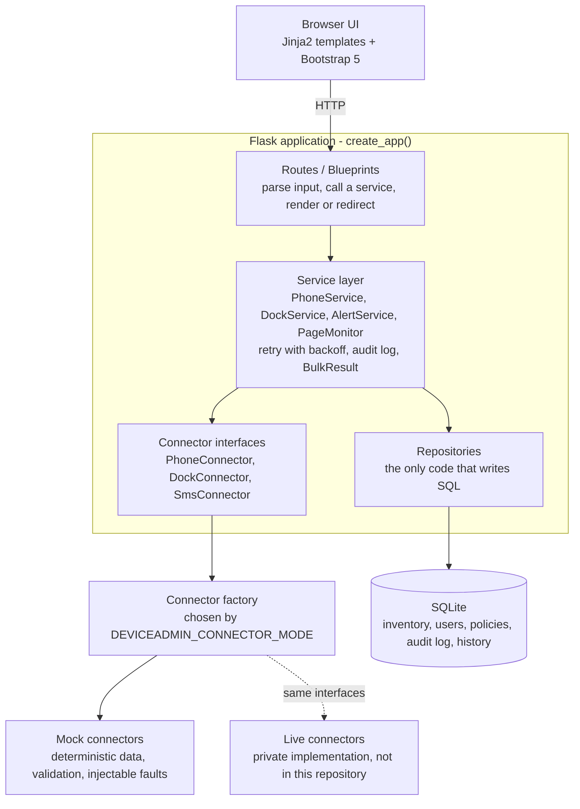
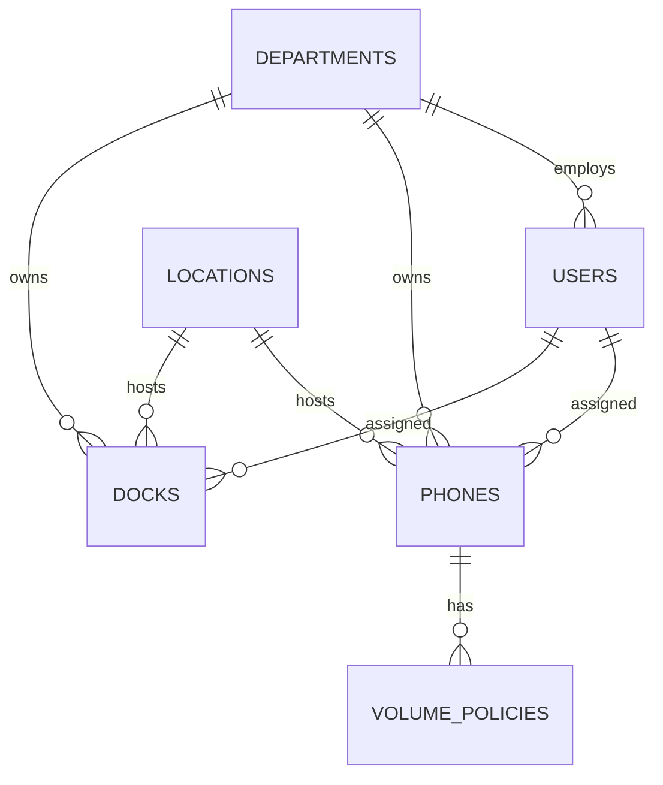
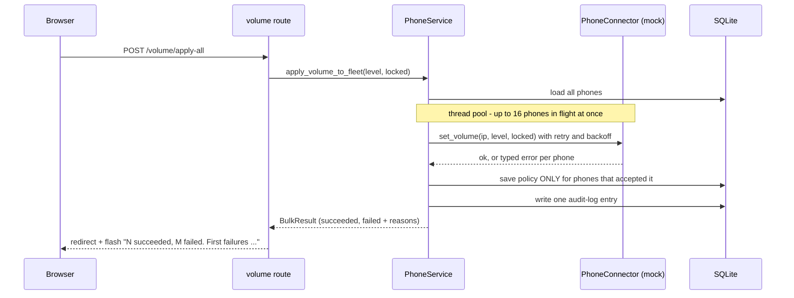

# Architecture

DeviceAdmin is a server-rendered Flask application organised in layers. Each layer
only talks to the one below it, and every external system sits behind an interface.

## System diagram



If Mermaid does not render for you, this is the same picture:

```
 Browser (Jinja2 + Bootstrap)
        |  HTTP
        v
 Routes / Blueprints ........ parse input, call a service, render/redirect
        |
        v
 Service layer .............. business rules, retry + backoff, audit logging
     |             |
     v             v
 Repositories    Connector interfaces (PhoneConnector, DockConnector, SmsConnector)
 (all SQL)             |
     |                 v
     v          Connector factory  --(DEVICEADMIN_CONNECTOR_MODE)-->  Mock connectors  [this repo]
  SQLite                                                         \-->  Live connectors  [private, not included]
```

## Layers and what each one is responsible for

| Layer | Code | Responsibility | Deliberately does NOT |
|---|---|---|---|
| Routes | `deviceadmin/routes/` | Read the request, call one service method, flash a message, render a template | Contain business rules or SQL |
| Services | `deviceadmin/services/` | Business rules, retry/backoff, audit logging, turning connector errors into results | Know how a device is reached (HTTP, PowerShell, ...) |
| Connector interfaces | `deviceadmin/connectors/base.py` | Define what the outside world can do + the typed errors it can raise | Contain any implementation |
| Mock connectors | `deviceadmin/connectors/mock.py` | Behave like real integrations: state, validation, latency, faults | Touch the network |
| Factory | `deviceadmin/connectors/factory.py` | Pick the implementation from configuration | Leak implementation types to callers |
| Repositories | `deviceadmin/database/repositories.py` | All SQL; allow-listed update columns; parameterised values | Contain business rules |
| Composition root | `deviceadmin/services/container.py` | Wire repositories + connectors + services together once | Run at import time (tests build their own) |

## The connector abstraction

```
Application -> Connector interface -> Mock connector -> Mock data
```

* **Three connectors**: `PhoneConnector` (desk-phone management API), `DockConnector`
  (dock firmware through the attached host computer) and `SmsConnector` (SMS gateway).
* Connectors **raise typed errors**; they never return `{"success": False}` dictionaries.

| Error | Meaning | `retryable` | Typical real-world equivalent |
|---|---|---|---|
| `ConnectorTimeout` | No answer in time | yes | socket/read timeout |
| `ConnectorUnavailable` | System down | yes | HTTP 502/503 |
| `RateLimitError` | Slow down (`retry_after`) | yes | HTTP 429 |
| `ConnectorAuthError` | Credentials rejected | no | HTTP 401/403 |
| `InvalidRequestError` | Our request was wrong | no | HTTP 400/422 |

* `call_with_retry` (services/common.py) retries only `retryable` errors with exponential
  backoff, honouring a rate limit's `retry_after`, and re-raises everything else immediately.
* **Mock behaviour is deterministic.** Whether a phone/host is "reachable" is derived from a
  CRC32 of its address, so demos and tests give the same answer every run. The seed data uses the
  same rule, so the inventory and the mock agree about which devices are offline.
* **Fault injection**: each mock has a `fault` (`none`, `outage`, `timeout`, `rate_limit`, `auth`).
  Set it from the Integrations page to watch retries, flash messages and audit entries react.

### Swapping in a real connector

1. Implement `PhoneConnector` / `DockConnector` / `SmsConnector` (same method names, raise the same errors).
2. Write `build_live_connectors(settings) -> ConnectorSet`.
3. `register_connector_set("live", build_live_connectors)` and run with `DEVICEADMIN_CONNECTOR_MODE=live`.

Services, routes, templates and tests are untouched. Contract tests for the real classes can
reuse the same assertions as `tests/test_*_connector.py`, pointed at an HTTP mock such as `responses`.

## Data model



Also (not drawn): `activity_log` (audit trail of every action), `firmware_history`, `alert_contacts` + `alert_history`, `page_notify_contacts`. `page_events` keeps the phone ids as plain columns (no foreign key) together with a snapshot of the source/target names, so history stays readable after a phone is deleted.
SQLite keeps setup to zero; the repository layer is the seam for moving to PostgreSQL.

## Key flows

### Apply a volume policy to the whole fleet



### Page monitor (background thread)

`PageMonitor.poll_once()` asks every online phone for active calls, matches a paging call's caller to a
known phone by extension then name, enforces a per-phone cooldown, records a `page_events` row, and texts the
notification list through `AlertService.send_one` (same retry policy as every other SMS).

## Concurrency model

* Fleet operations are I/O bound, so network calls fan out over a `ThreadPoolExecutor`
  (`PhoneService._fan_out`). Database writes happen afterwards on the calling thread, so SQLite sees
  one writer.
* The app runs **one** gunicorn worker with several threads, because the page monitor is a background
  thread and SQLite is a single-writer file. Scaling out means: PostgreSQL + a separate worker/scheduler
  process for the monitor (see the README's Future Improvements).

## Testing strategy

| Test file | Level | What it proves |
|---|---|---|
| `test_phone_connector.py`, `test_dock_connector.py`, `test_sms_connector.py` | Unit (connector contract) | Structures, validation, state, faults, rate limits |
| `test_resilience.py` | Unit | Which errors retry, backoff timing, `retry_after` |
| `test_services.py`, `test_page_monitor.py` | Service / integration (real SQLite, mock connectors) | Business rules, partial failures, cooldown |
| `test_database_and_seed.py` | Repository + data | Allow-listed columns, cascades, seed is large, deterministic and provably fictional |
| `test_web.py`, `test_web_workflows.py` | HTTP integration | Every page renders (with and without data), forms, error messages, regression tests |
| `test_audit_script.py` | Tooling | The sanitization audit catches secrets/IPs/emails/phones and passes on this repo |

## Design decisions and tradeoffs

* **Connector abstraction over scattered `if simulation_mode:`** - the original adapters mixed real and fake
  behaviour in each method; separating them makes both testable and the swap a one-liner. Cost: more files.
* **Services return results instead of raising to routes** - routes stay trivial and every failure becomes
  an audit entry plus a friendly message. Cost: callers must check `.ok`.
* **Policies saved only after the device accepts them** - the database should never claim a phone is locked
  if it is not.
* **Dicts from repositories, not model classes** - less code for a project this size; typed models/ORM would be
  the next step as the schema grows.
* **Server-rendered pages** - no build step, easy to read and test. Cost: no live updates (page reload).
* **No authentication yet** - acceptable for a local demo; it is the first production gap (see README).
